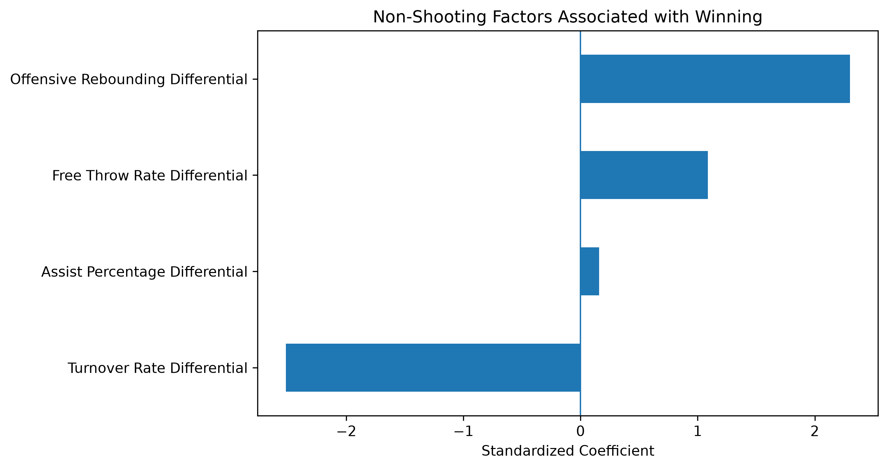

# Winning Without Outshooting

## Overview

Shooting efficiency is one of the biggest factors in deciding who wins an NBA game. For this project, I wanted to look at what happens when that advantage is mostly taken away.

My question was:

**When two NBA teams shoot about equally well, what other factors are most associated with winning?**

I used team-level data from the 2024–25 NBA regular season and focused only on games where the two teams had effective field goal percentages within 2 percentage points of each other.

## Data

The original dataset had 2,460 team-game rows, which represented 1,230 NBA games.

Each game appeared twice, once for each team, so I combined the two rows into one row per game.

I also found 5 games with unusual home and away labels, so I removed those before continuing. That left 1,225 games.

The main statistics I looked at were:

- Effective field goal percentage
- Turnover percentage
- Offensive rebounding percentage
- Assist percentage
- Total rebounding percentage
- Free throw rate

Free throw rate was calculated as:

`FTA / FGA`

I then kept only games where the effective field goal percentage difference was 2 percentage points or less:

`|eFG% differential| <= 0.02`

That left 210 games for the main analysis.

## Data Source

The game-level NBA data came from the `llimllib/nba_data` public GitHub repository, which provides team game logs and advanced NBA statistics.

For this project, I used the 2024–25 team game log file.

## Method

For each game, I calculated the difference between the home team and away team for each statistic.

For example:

`turnover differential = home TOV% - away TOV%`

A negative turnover differential is beneficial for the home team because it means they turned the ball over less than their opponent.

I first compared the average differences between games where the home team won and games where the home team lost.

After that, I built a logistic regression model using:

- Turnover rate differential
- Offensive rebounding differential
- Free throw rate differential
- Assist percentage differential

Originally, I also looked at total rebounding differential, but it had a correlation of about 0.97 with offensive rebounding differential, so I left it out of the model to avoid using two variables that seemed redundant.

I also standardized the predictors before fitting the final model so they were all on a more comparable scale.

## Results

In games where shooting efficiency was similar, winning teams generally:

- Turned the ball over less
- Had a stronger offensive rebounding advantage
- Had a higher free throw rate
- Had a slight advantage in assist percentage

The standardized logistic regression coefficients were:

| Predictor | Coefficient |
|---|---:|
| Turnover Rate Differential | -2.516 |
| Offensive Rebounding Differential | 2.300 |
| Free Throw Rate Differential | 1.088 |
| Assist Percentage Differential | 0.157 |

The strongest factors in the model were turnover differential and offensive rebounding differential.

The final model had:

- 86.8% accuracy on the test set
- 0.940 ROC-AUC on the test set
- 88.1% average accuracy across five-fold cross-validation
- 0.951 average ROC-AUC across five-fold cross-validation

Overall, the results suggest that when shooting is about equal, taking care of the ball and creating extra possessions through offensive rebounds are especially important.

## Model Visualization

## Limitations

This project only uses the 2024–25 NBA regular season.

The 2 percentage point eFG% cutoff was a choice I made to define games where teams shot similarly, so a different cutoff could give different results.

The model also uses statistics from the game itself. Because of that, this is not meant to be a pregame prediction model. The goal is to understand which non-shooting factors separate winners from losers when shooting efficiency is similar.

## Project Structure

- `notebooks/` - Jupyter notebook containing the cleaning, analysis, and modeling
- `data/raw/` - original team game-level data used in the project
- `data/processed/` - cleaned close-shooting game dataset
- `figures/` - visualizations created during the analysis
- `requirements.txt` - Python packages used for the project

## Tools

Python, pandas, Matplotlib, scikit-learn, Jupyter Notebook, Git, and GitHub